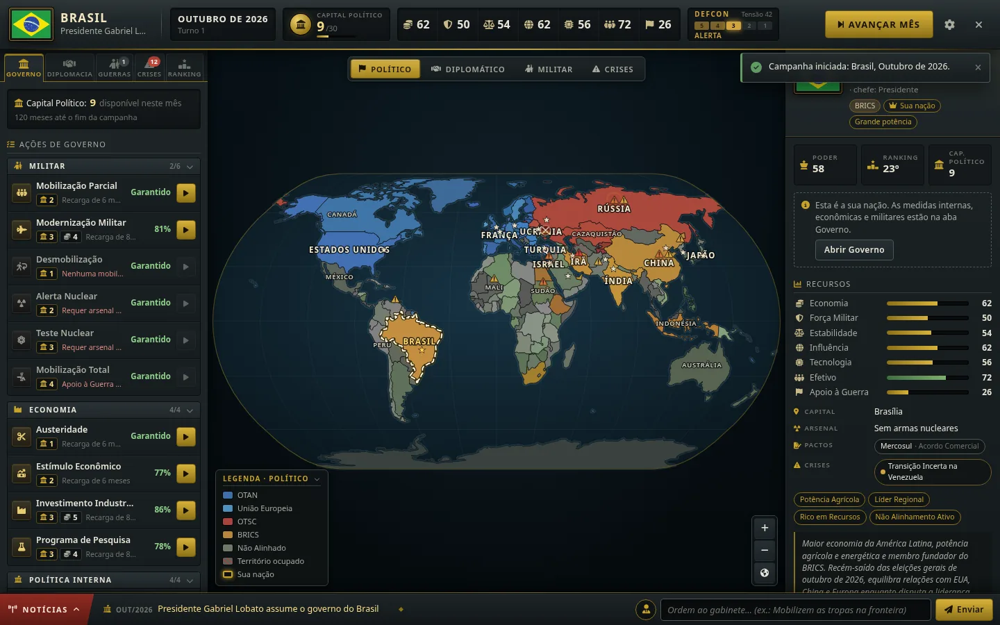
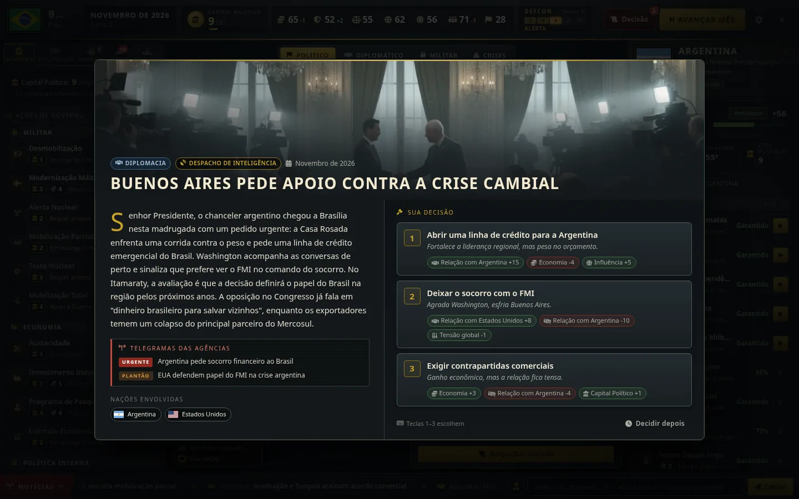
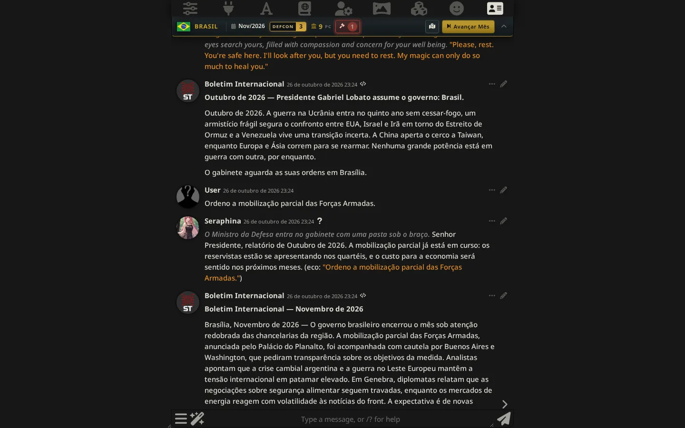
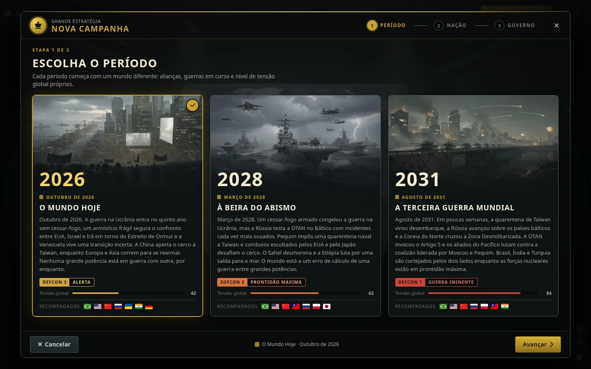
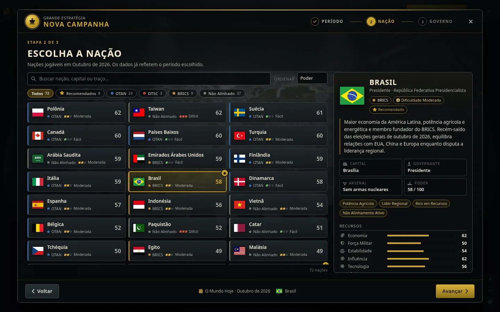
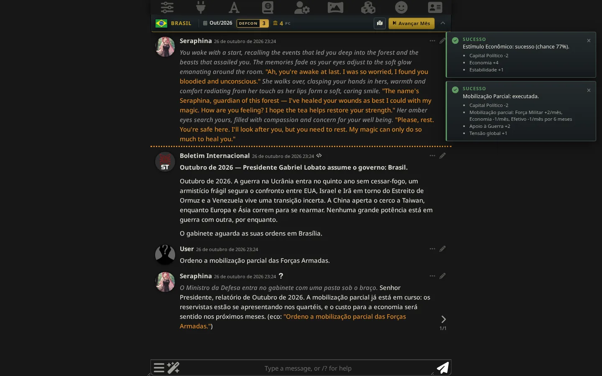
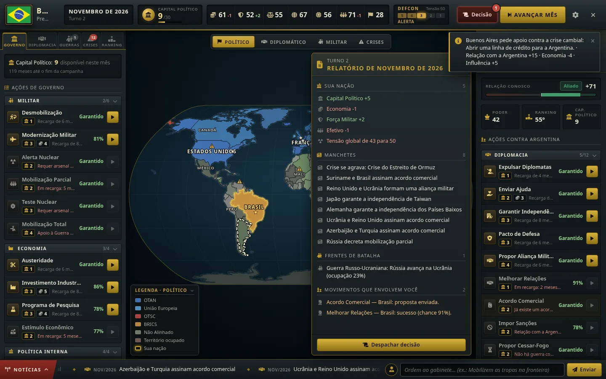
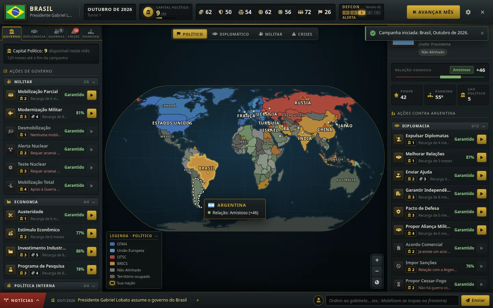
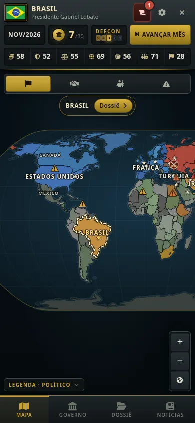

# Grande Estratégia — uma campanha estilo Hearts of Iron dentro do SillyTavern

Você é o chefe de Estado. Escolha um período (2026, 2028 ou 2031), uma nação entre 72 e o seu
nome como governante. A **Sala de Guerra** mostra o mapa-múndi, os recursos do seu país, as
guerras, as crises e as ações de governo. O chat continua sendo o seu SillyTavern de sempre, com
o seu preset e o seu personagem: a extensão só acrescenta um relatório de situação ao prompt, e
as ordens que você dá no chat viram ações de verdade no jogo.



## Como funciona

- **O motor decide, o chat narra.** Recursos, guerras, relações e crises mudam só por regras
  determinísticas (com dados e custos). A IA escreve os eventos, os boletins e as falas do
  gabinete, mas não consegue inventar números.
- **Ordens no chat.** Escreva como governante: *"Ordeno a mobilização parcial das Forças
  Armadas"* ou *"Quero melhorar as relações com a Argentina"*. Antes da resposta, um árbitro
  converte a ordem em ações do catálogo, o motor as executa (com custo e chance de sucesso) e o
  resultado entra no relatório de situação. A resposta do personagem já narra o que aconteceu.
  Regenerar ou trocar de swipe não executa a ordem de novo.
- **Turnos mensais.** Em **Avançar Mês** o mundo se move: as outras nações agem, as frentes de
  batalha andam, crises surgem e se resolvem, a tensão global sobe ou cai. Depois a IA escreve
  uma decisão para você, baseada no estado do jogo e nas últimas mensagens do chat, e um
  **Boletim Internacional** é publicado no chat.
- **Cada chat é uma campanha.** O estado fica salvo nos metadados do chat. Trocar de chat troca
  de campanha.



## Conteúdo

| | |
|---|---|
| Períodos | **2026 — O Mundo Hoje** (tensão 42), **2028 — À Beira do Abismo** (62), **2031 — A Terceira Guerra Mundial** (84, com frentes ativas na Europa, no Pacífico e na Coreia) |
| Nações | 171 países no mapa, 72 jogáveis, com recursos, personalidade de IA, arsenal nuclear e pactos (OTAN, OTSC, Mercosul, ANZUS...) |
| Ações | 35 ações em 5 áreas: diplomacia, militar, economia, política interna e inteligência |
| Guerra | Frentes com ocupação, exaustão, chamados às armas, cessar-fogo, termos de paz, fantoches e anexação |
| Mapa | Modos político, diplomático, militar e de crises, zoom e arraste, marcadores de frente e de crise |
| Fim de jogo | Vitória ao chegar ao fim do período com a nação de pé (ou hegemonia); derrota por anexação, golpe de Estado ou guerra nuclear global (tensão 100) |

## Instalação

1. No SillyTavern, abra **Extensões → Instalar extensão** e cole
   `https://github.com/gplobato3/Stfork`.
2. Recarregue a página. Requer SillyTavern 1.13 ou mais recente (testado no 1.19).
3. Opcional: em **Extensões → Grande Estratégia**, clique em **Importar personagem "Conselho de
   Guerra"**. É um personagem mestre de jogo que dá voz ao gabinete (Defesa, Relações
   Exteriores, Economia, Inteligência, Interior). A extensão funciona com qualquer personagem;
   este só foi escrito para o jogo.

Não há `npm install` para jogar: a extensão não tem dependências em tempo de execução.

## Como jogar

1. Abra um chat com o personagem que quiser, com o seu preset de sempre.
2. Abra o **menu da varinha → Grande Estratégia** (ou digite `/hoi`) e clique em
   **Iniciar campanha**.
3. Escolha o período, a nação e o nome do governante. Uma mensagem de abertura aparece no chat.
4. Na Sala de Guerra: clique num país para ver o dossiê e as ações sobre ele; a aba **Governo**
   tem as ações internas. Cada ação custa **Capital Político**, que se renova todo mês.
5. Converse no chat como governante. Ordens viram ações; conversa normal continua conversa.
6. Clique em **Avançar Mês** (na Sala de Guerra ou na barra acima do chat), leia o relatório e
   tome a decisão do mês.



### Comandos de barra

| Comando | Faz |
|---|---|
| `/hoi` | Abre a Sala de Guerra |
| `/hoi-novojogo` | Nova campanha |
| `/hoi-turno` | Avança um mês |
| `/hoi-ordem <texto>` | Interpreta e executa uma ordem |
| `/hoi-acao acao=<id> alvo=<ID>` | Executa uma ação do catálogo (ex.: `acao=dip_send_aid alvo=ARG`) |
| `/hoi-decisao` | Reabre a decisão pendente |
| `/hoi-status` | Retorna o relatório de situação (útil em STscript) |
| `/hoi-salvar`, `/hoi-apagar` | Salva / apaga a campanha deste chat |

Os comandos também aceitam nomes em inglês (`/hoi-newgame`, `/hoi-endturn`, `/hoi-order`...).

### Macros para presets

Se você prefere controlar onde o contexto do jogo entra no prompt, desligue a injeção automática
nas configurações e use as macros no seu preset ou no card: `{{hoi_sitrep}}`, `{{hoi_nation}}`,
`{{hoi_leader}}`, `{{hoi_title}}`, `{{hoi_date}}`, `{{hoi_defcon}}`, `{{hoi_orders}}`.

## Integração com o seu preset

- O relatório de situação entra pelo mesmo mecanismo do Author's Note e do Summarize
  (`setExtensionPrompt`), como mensagem de **sistema**, por padrão na profundidade 1. Posição,
  profundidade, papel e nível de detalhe são configuráveis. Nada do seu preset é substituído.
- Eventos e o árbitro de ordens usam saída estruturada (JSON Schema) quando a API é de Chat
  Completion. Em Text Completion o formato vai no próprio prompt e a resposta é lida com
  tolerância a erros. Se a resposta não servir, há uma nova tentativa e, por fim, um evento
  local, então o jogo nunca trava.
- Os boletins usam a geração "quiet" do SillyTavern, então saem na voz do seu preset.
- Em **Configurações → Perfil de conexão do motor** você pode apontar eventos e árbitro para
  outro perfil do Connection Manager (por exemplo, um modelo mais barato), mantendo o chat no
  seu modelo principal.

## Configurações

Ficam em **Extensões → Grande Estratégia**: injeção do relatório (posição, profundidade, papel,
detalhe), modo de ordens (automático, só por comando, desligado), eventos por IA, boletins no
chat, perfil de conexão do motor, limite de tokens dos eventos, barra no chat, ilustrações e
dificuldade das novas campanhas.

O modo automático de ordens faz uma chamada extra ao modelo a cada mensagem sua enquanto houver
campanha. Se isso pesar no custo ou na latência, use o modo "só por comando" (`/hoi-ordem`).

## Mais telas

| | |
|---|---|
|  |  |
|  |  |
|  |  |

## Desenvolvimento

```sh
npm install          # só ferramentas de desenvolvimento (mapa, bandeiras)
npm run check        # sintaxe, JSON, import em node e dados do cenário
npm test             # 300 testes (node:test)
npm run build:map    # regenera assets/map/world.map.json
npm run build:flags  # regenera assets/flags/
REPLICATE_API_TOKEN=... npm run build:art   # regenera as ilustrações (o token nunca é gravado)
```

Arquitetura e contratos entre módulos: [`docs/DESIGN.md`](docs/DESIGN.md). O que estava errado
na v1: [`docs/AUDIT.md`](docs/AUDIT.md).

## Créditos e licença

- Mapa: Natural Earth (domínio público). Bandeiras: [flag-icons](https://github.com/lipis/flag-icons)
  (MIT, ver `assets/flags/LICENSE-flags.md`). Ilustrações geradas com FLUX.2 [pro] via Replicate.
- Os cenários de 2028 e 2031 são ficção. Nenhum líder real é citado pelo nome.
- Licença: AGPL-3.0-or-later ([`LICENSE`](LICENSE)).
